# How the SDD harness works

A visual guide to the `sdd` plugin: how one sentence becomes a reviewed pull request, who does
each step, what each agent is allowed to see, and how the harness gets into (and stays current
in) your repositories. The diagrams are [Mermaid](https://mermaid.js.org/), so they render on
GitHub.

This page explains; it does not define. The procedure is
[`ship-runbook.md`](../plugins/sdd/standards/ship-runbook.md), the design reasons are in
[`agent-pipeline.md`](../plugins/sdd/standards/agent-pipeline.md), and the role contracts are in
[`harness.md`](../plugins/sdd/standards/harness.md). When this page and those disagree, they win.
It describes sdd **0.19.0**.

Commands are written in plugin form (`/sdd:ship`). In a [flat copy](installation.md#flat-copy-recommended)
they have no namespace (`/ship`), and in Codex they are `$ship`.

- [The agentic SDLC in one picture](#the-agentic-sdlc-in-one-picture)
- [What the harness is made of](#what-the-harness-is-made-of)
- [One `/sdd:ship` run, step by step](#one-sddship-run-step-by-step)
- [Retry budgets and escalation](#retry-budgets-and-escalation)
- [Profiles: scaling the pipeline to the risk](#profiles-scaling-the-pipeline-to-the-risk)
- [Who sees what: context isolation and tool contracts](#who-sees-what-context-isolation-and-tool-contracts)
- [What a run leaves in your repository](#what-a-run-leaves-in-your-repository)
- [Where the orchestrator lives](#where-the-orchestrator-lives)
- [One harness, three coding agents](#one-harness-three-coding-agents)
- [Installing and upgrading](#installing-and-upgrading)
- [Layering: framework, platform, product repos](#layering-framework-platform-product-repos)

---

## The agentic SDLC in one picture

`/sdd:ship <feature>` is the single entry point for a code change. It walks the change through
the same lifecycle a careful team would: agree what to build, design it, build it test-first,
have it reviewed and tested by someone who did not write it, and open a pull request that CI
has to pass. A person is in the loop at two points: approving the spec, and reviewing and
merging the PR.

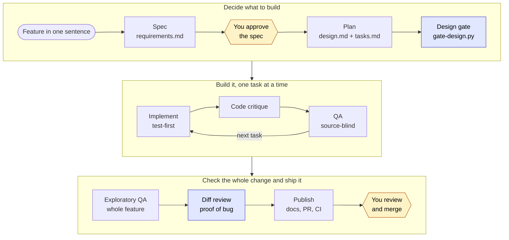

`--autonomous` removes the spec approval and runs to an open PR. Merging is never automated.

---

## What the harness is made of

The plugin lives in `plugins/sdd/` here, and in `.claude/` after a flat copy. It is mostly Markdown. Each kind of file has one job, and they point at each other
rather than repeating each other: a skill links to the standard it follows instead of copying
its rules.

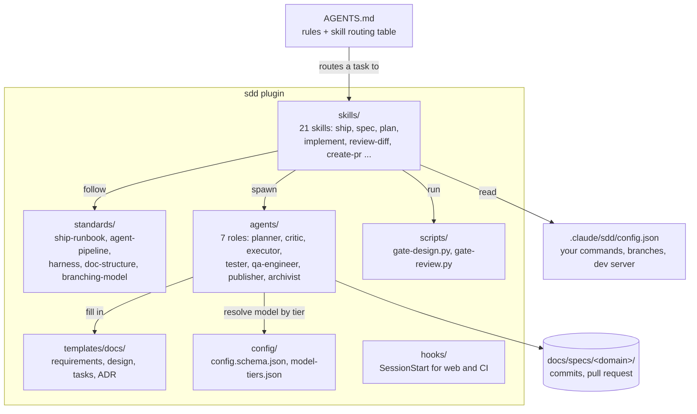

| Kind | Answers | Read by |
|---|---|---|
| Standard | *What* the rules are | People and agents |
| Skill | *How* an agent runs a workflow | Agents (you invoke them) |
| Agent role | *Who* does one job, with which tools | The skill that spawns it |
| `config.json` | *Which* commands and branches this repo uses | Skills, through placeholders such as `<TEST_CMD>` |
| Gate script | *Whether* an artifact passes a mechanical check | The orchestrator; exit 0 or 1 |

The full skill list is in [Plugins](plugins.md); the config keys are in
[Configuration](configuration.md).

---

## One `/sdd:ship` run, step by step

The session you type `/sdd:ship` into is the **orchestrator**. It follows the runbook, writes the
spec, design, tasks and PR itself, and spawns a separate agent for every step that needs
independence or a clean context. It never writes product code or tests.

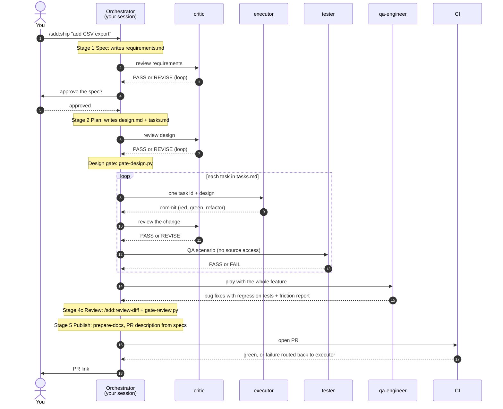

| Stage | Who | Produces |
|---|---|---|
| 1 Spec | Orchestrator, following `planner.md`; critic loop | `requirements.md` with Given/When/Then acceptance criteria |
| 2 Plan | Orchestrator, following `planner.md`; critic loop | `design.md` (architecture, decisions, failure modes, test and QA scenarios), `tasks.md`, optional issues |
| Design gate | `gate-design.py` | Exit 0, or one `FAIL:` line per problem |
| 3 Implement | `executor`, one per task | One commit per task, tests first |
| Mutation gate | `commands.mutate` on the diff | Surviving mutants killed by new tests (`strict` or `--mutate`) |
| Code critique | `critic` | PASS or REVISE per task |
| 4 QA | `tester` | PASS or FAIL per task, from the outside |
| 4b Explore | `qa-engineer`, once | Fixes for confirmed bugs, a friction report for the PR |
| 4c Review | `/sdd:review-diff` + `gate-review.py` | `.review/findings.json`; at most two passes |
| 5 Publish | Orchestrator, following `publisher.md` | Docs sealed, PR opened, CI watched |

### Test-first, and in `strict` adversarially so

Under `standard` one executor does red, green and refactor in a single commit. Under `strict` the
tests and the code come from two executor invocations with opposite goals, so the code cannot be
shaped around tests it wrote for itself:

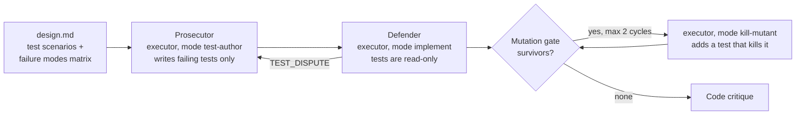

---

## Retry budgets and escalation

Every loop has a budget. When one runs out, the run stops and tells you which budget, gate or
design gap needs a decision. It never skips a gate, edits a gate script, or relaxes the profile
to get past one.

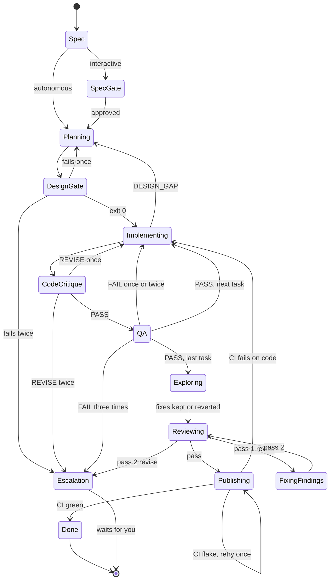

The authoritative version, including the `fast` shortcuts, is the
[state machine in the runbook](../plugins/sdd/standards/ship-runbook.md#state-machine).

---

## Profiles: scaling the pipeline to the risk

`--profile` (or `pipeline.profile` in `config.json`) picks how much of the pipeline runs:
`fast` for small bugfixes, UI tweaks and docs; `standard` (the default) for ordinary features and
fixes; `strict` for payments, auth, data loss and concurrency.

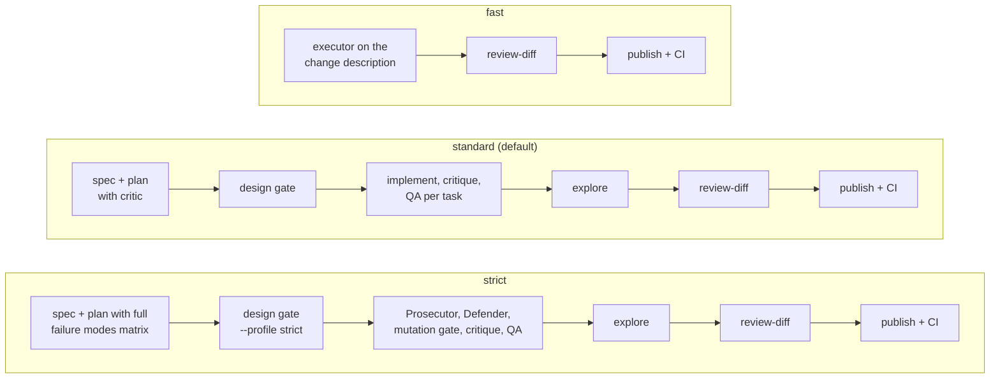

Flags beat the profile for one run: `--explore` / `--no-explore` and `--mutate`. If a `fast`
change turns out to need a design decision, the run stops and asks whether to rerun with
`--profile standard`. The per-stage table is in the
[runbook](../plugins/sdd/standards/ship-runbook.md#profiles).

---

## Who sees what: context isolation and tool contracts

Independence is the point of having separate agents, so each one gets only the inputs its job
needs. A critic that saw the executor's reasoning would tend to agree with it; a tester that
could read the code would grade the code instead of the behaviour.

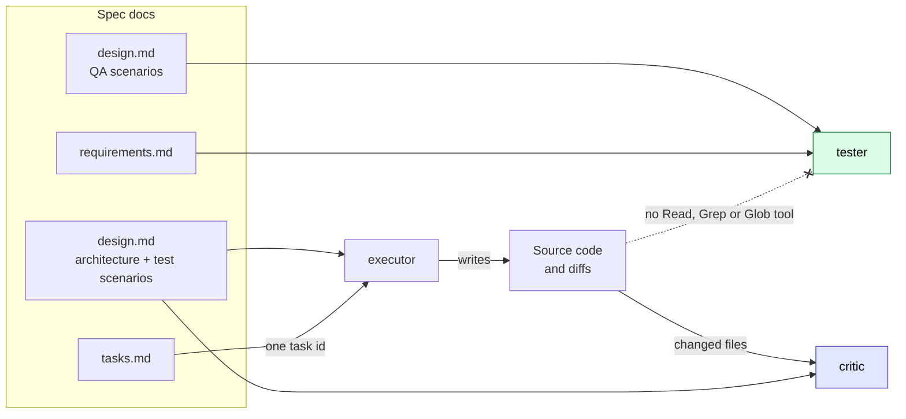

In Claude Code the boundary is enforced by each agent's `tools:` list, not by asking nicely: a
tool that is not declared cannot be called. Every agent declares a role, and every role has a
contract that `scripts/check-all.sh` checks.

| Role | Agents | Contract |
|---|---|---|
| author | `planner`, `executor`, `qa-engineer` | Needs `Read` and `Write`; writes specs, plans or code |
| reviewer | `critic` | No write tool: it cannot change what it judges |
| verifier | `tester` | No `Read`, `Grep` or `Glob`: it cannot see the implementation |
| orchestrator | `publisher` | Must declare `Agent`; broad access |
| auditor | `archivist` | Read-only inspection and reporting |

Each role also declares a model **tier** (`workhorse` for planner, critic, publisher, archivist
and qa-engineer; `fast` for executor and tester), resolved per provider through
`config/model-tiers.json`. In Codex the same contracts are instructions rather than enforced
tool lists. Details: [harness.md](../plugins/sdd/standards/harness.md#agent-roles-and-tool-contracts)
and the [context engineering table](../plugins/sdd/standards/ship-runbook.md#context-engineering-rules).

---

## What a run leaves in your repository

Specs are the source of truth, so they are written before code and kept current as the code
changes. A domain's docs move through `Draft` → `Review` → `Approved`.

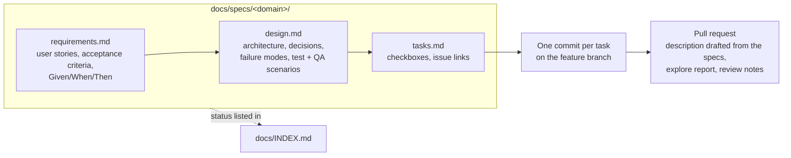

Acceptance criteria freeze when the design is approved. If a QA scenario later has to change,
that is a recorded decision in the design's Decisions table, never a quiet edit to make a test
pass. The layout rules are in
[doc-structure.md](../plugins/sdd/standards/doc-structure.md).

---

## Where the orchestrator lives

The orchestrator is always the session you started `/sdd:ship` in. That is a deliberate change
over several releases:

| Version | Orchestration |
|---|---|
| up to 0.14 | An `architect` subagent ran the pipeline and spawned every stage |
| 0.15.0 | Inline in the calling session by default; `architect` kept as an opt-in for several missions per session |
| 0.16.0 | The inline session also writes the spec, plan and PR itself instead of spawning `planner` and `publisher` |
| 0.19.0 | Inline only; the `architect` agent and `pipeline.orchestrator` are gone |

Keeping planning and publishing in your session means the spec approval is a normal back and
forth with you, and nothing has to be relayed up through nested subagents. To run several
features at once, run several sessions: a host such as
[agent-anywhere](https://github.com/zenithml/agent-anywhere) starts one thread per feature, and
each thread runs its own `/sdd:ship`.

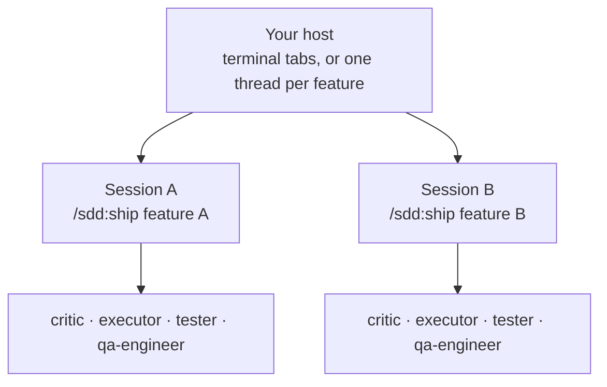

Running one stage on its own (`/sdd:spec`, `/sdd:plan`, `/sdd:publish`) still spawns that
stage's agent; that path is for resuming or debugging.

---

## One harness, three coding agents

There is one canonical copy of the skills and roles. Claude Code, Codex and Antigravity (`agy`)
all read it; nothing is generated per client except Codex's MCP block.

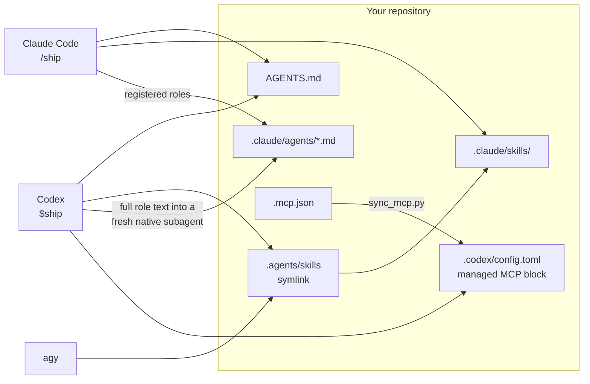

How delegation and model selection work across hosts is the
[delegation contract](../plugins/sdd/standards/agent-pipeline.md#cross-harness-delegation);
setup is [Using Codex](installation.md#using-codex).

---

## Installing and upgrading

Three routes get the plugin into a repository; they differ only in how the files arrive.

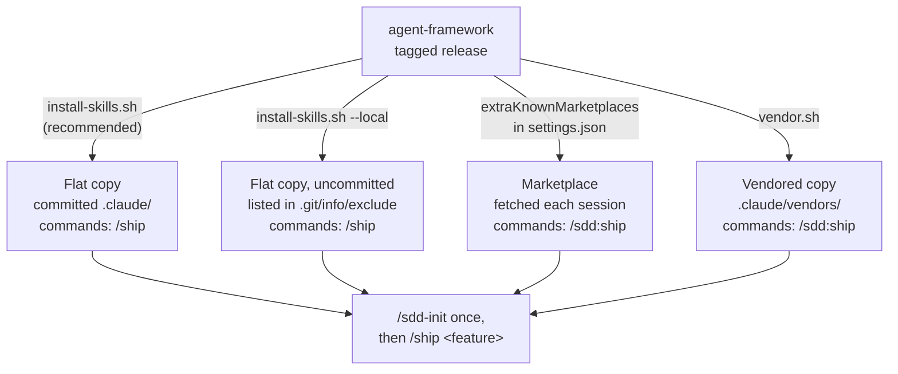

### How a flat-copy upgrade keeps your edits

A flat install writes `.claude/sdd/.harness-manifest`, the hash of every file it installed.
Re-running `install-skills.sh` from a newer checkout compares each file three ways (your copy, the
manifest, the new upstream) so it can tell your edits from upstream changes:

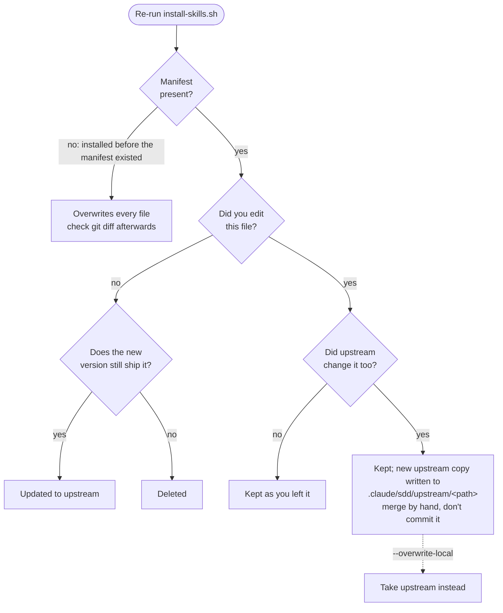

Compare `.claude/sdd/.harness-version` with this repo's plugin version to see whether a
consumer is behind. Every route is exercised in CI by `tests/install-paths.sh`; the commands are
in [Installation](installation.md).

---

## Layering: framework, platform, product repos

This repository is public and generic. An organisation that wants private plugins, private
integrations or a single pinned version across many repositories can put a thin **platform
layer** between the framework and its product repositories:

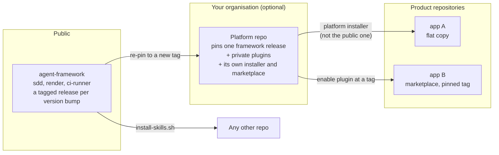

The rules that keep the layers honest:

- **Framework changes go upstream.** A fix to a skill, agent or standard is a pull request to
  agent-framework, then a re-pin in the platform, then a refresh in each product repo. A change
  can therefore take one PR per layer.
- **A product repo installs from the layer directly above it.** The platform's installer runs
  the pinned framework release's own `install-skills.sh`, then copies the private plugins on top,
  so the flat copy and the marketplace route resolve to the same versions. Running the public
  installer in a platform-managed repo would install a different release and leave the private
  plugins out.
- **Never re-run an installer on a repo that has no `.harness-manifest`** without checking
  `git diff` afterwards: without the manifest it cannot tell your edits from stale files.

A repository with no platform layer simply installs from agent-framework, as in
[Installing and upgrading](#installing-and-upgrading).
